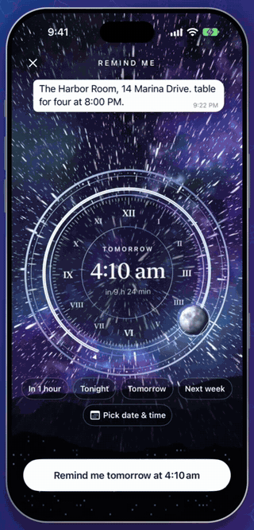
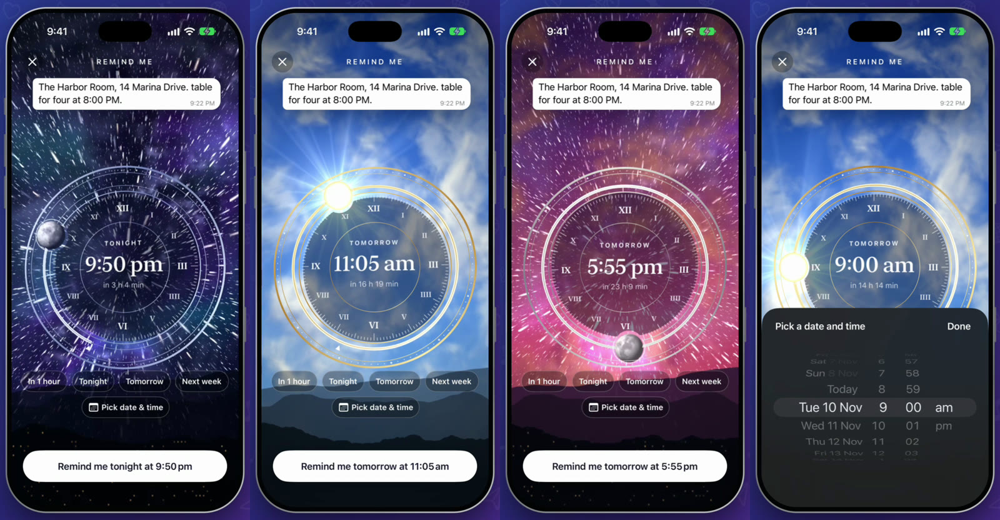

# Remind Dial

Someone sends you an address, a flight time, a thing to do later. You read it, you mean to come back, and
you never do. Telegram can already remind you, but you have to forward the message to Saved Messages and
schedule it yourself, and then the reminder has no way back to the chat it came from.

So long-press any message and tap **Remind Me**. The screen turns into a sky with a dial in the middle.
Turn it and the sky turns with it: moon and stars at night, sunrise as you pass six, full sun at noon, a
red sunset, then stars again. When you like the time, press the button that says exactly what it will do.
When the moment comes you get a real Telegram reminder, and tapping it takes you back to the original
message.

This is a patch for the real Telegram for iOS, not a mock-up. The video was recorded from the app built
with this code, on a real account.

<p align="center">
  
</p>

▶︎ [Media/demo.mp4](Media/demo.mp4) is the full video (30 seconds).



## Where each part is

Everything sits at the same path it has inside Telegram-iOS, so `submodules/` can be copied straight
over a checkout.

### New files

| Part | File | What it does |
|---|---|---|
| The sky | [`RemindSkyRenderer.swift`](submodules/TelegramUI/Components/Chat/RemindDial/Sources/RemindSkyRenderer.swift) | Metal drawing of the whole background: sky colors by hour, clouds, stars, nebula, aurora, mountains, and the sun and moon. |
| The dial | [`RemindDialView.swift`](submodules/TelegramUI/Components/Chat/RemindDial/Sources/RemindDialView.swift) | The rings, turning, shortcuts, the date picker, the confirm button and the fold animation. |
| Connecting it to a chat | [`ChatControllerRemindDial.swift`](submodules/TelegramUI/Sources/ChatControllerRemindDial.swift) | Lifts the message out of the chat, opens the dial, and schedules the reminder with Undo. |
| Bazel target | [`BUILD`](submodules/TelegramUI/Components/Chat/RemindDial/BUILD) | The `RemindDial` module. |

### Changes to Telegram's own files

One patch per part. They touch different files, so the order doesn't matter.

| Part | Patch | Files | What changes |
|---|---|---|---|
| Menu item | [`01-context-menu.patch`](patches/01-context-menu.patch) | `ChatInterfaceStateContextMenus.swift` | Adds **Remind Me** after Forward. |
| Reminder banner | [`02-reminder-banner.patch`](patches/02-reminder-banner.patch) | `ApplicationContext.swift` | Tapping a reminder opens the original chat and highlights the message. |
| Status bar | [`03-status-bar.patch`](patches/03-status-bar.patch) | `ChatController.swift`, `ChatControllerNode.swift` | Keeps the status bar white while the dial is open. |
| Bazel dependency | [`04-build-dependency.patch`](patches/04-build-dependency.patch) | `TelegramUI/BUILD` | Adds the new module to TelegramUI. |

## How it works

**A real reminder.** There's no new backend. A reminder is the message forwarded to your Saved Messages
and scheduled for the chosen minute, which is the same thing Telegram already delivers and notifies you
about. So it works across your devices. Nobody else receives anything.

**The sky.** It's one fragment shader driven by the hour under the dial. Sky colors blend between night,
day and a golden band around six. Clouds are layers of noise lit from wherever the sun is.

**Depth.** Stars and clouds are stacks of layers that grow toward you and fade out as they pass, so
turning the dial flies you through them. The faster you turn, the longer the stars stretch.

**The sun and moon.** They're drawn as spheres in the same shader, so they light the clouds around them.
The rings are cut out around them, so they sit in front of the dial.

**The dial.** Its rings sit at different depths and tilt slightly as you turn. The position of the sun is
worked out through the same 3D transform, so it stays exactly on the ring.

**Nothing happens by accident.** Letting go of the dial or tapping a shortcut only moves the time. The
reminder is set only by the button, and even then there are five seconds to undo it.

## Try it

This applies to Telegram-iOS at commit `24638bc69bd083981b178dd1e7f921eebbf7fc46`.

```sh
git clone --recursive https://github.com/TelegramMessenger/Telegram-iOS.git
cd Telegram-iOS
git checkout 24638bc69bd083981b178dd1e7f921eebbf7fc46
git submodule update --init --recursive

git clone https://github.com/Amithkodjj/telegram-remind-dial.git ../remind
cp -R ../remind/submodules/. submodules/
git apply ../remind/patches/*.patch
```

Then build it the way [Telegram's README](https://github.com/TelegramMessenger/Telegram-iOS#readme)
describes, with your own `api_id`. This repo compiles on its own against that commit, without my other
patches.

## Numbers to play with

| Value | Default | Where | Meaning |
|---|---|---|---|
| Dial turn | 720 minutes | `RemindDialView` | One full turn is 12 hours |
| Dial step | 5 minutes | `applyMinute` | How far each tick moves |
| Furthest date | 365 days | `maximumMinute` | How far ahead you can go |
| `m34` | -1/620 | `layoutDial` | Strength of the 3D perspective |
| `strength` | 0.09, 0.17 while dragging | `layoutDial` | How far the dial tilts |
| Star layers | 6 | `stars()` in the shader | Depth of the star field |
| Cloud layers | 3 | `skyFragment` | Depth of the clouds |

## Notes and limits

* It works on messages already sent to the cloud, and isn't offered on copy-protected ones.
* The earliest time is two minutes ahead in the picker and five on the dial.
* Telegram delivers scheduled messages up to about a minute after the chosen time.
* Tapping the reminder returns to the original message from the in-app banner. Opening it from a system
  notification with the app closed hasn't been tested and may land in Saved Messages instead.
* The labels are English only for now.
* The sky is drawn live on the GPU. It stops as soon as the dial closes.
* Tested on the iOS 27.2 Simulator (iPhone 18 Pro) in a debug build. It hasn't been run on a physical
  iPhone yet, so the sky's frame rate on a real device isn't measured.

Built on [Telegram-iOS](https://github.com/TelegramMessenger/Telegram-iOS) and published to follow its
licence terms. The stretchy unread badge, paper plane forward and silk bookmark are separate projects in
their own repositories.
